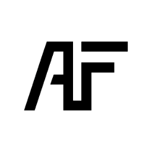
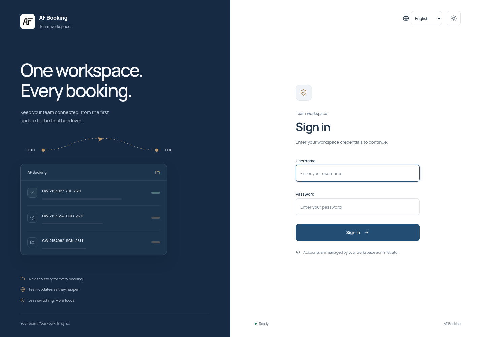
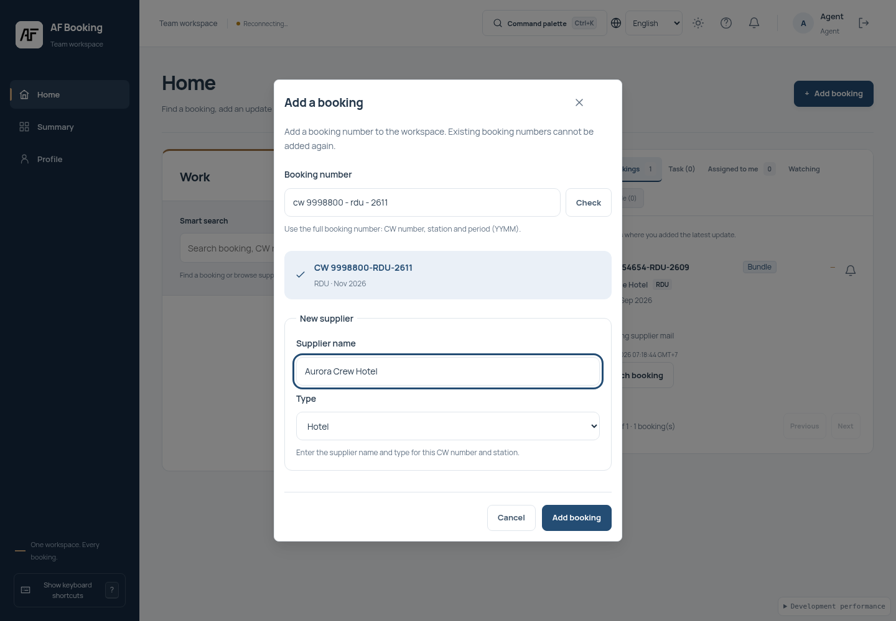
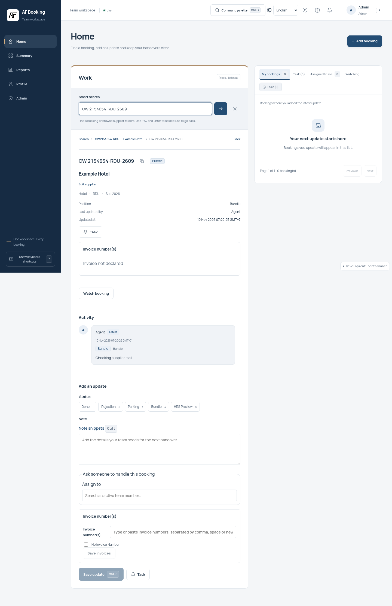

<div align="center">
  

  

  <h1>AF Booking</h1>
  <p><strong>A focused operations workspace for booking teams.</strong></p>
  <p>
    <a href="https://github.com/LuongNuong131/AF_Booking/actions/workflows/ci.yml"></a>
    <a href="#technology"></a>
    <a href="#technology"></a>
    <a href="#project-status"></a>
  </p>
</div>

> **AF Booking** turns booking updates into a shared, searchable and accountable workspace — so every teammate can see what happened, who owns the next action and what still needs attention.

<p align="center">
  <a href="#product-surface">Product surface</a> ·
  <a href="#architecture">Architecture</a> ·
  <a href="#local-development">Run locally</a> ·
  <a href="#documentation">Documentation</a>
</p>

## Why AF Booking exists

Booking transactions may already happen in another system. AF Booking does not try to replace that system. It provides the operational layer around it: add a booking number, find the canonical workspace, record the latest update, hand work over clearly and keep the history auditable.

The product is intentionally built around three questions:

- **What is the current state of this booking?**
- **Who owns the next action?**
- **What changed, when and by whom?**

The result is a calm internal console for Agent, QC and Admin teams — optimized for clarity, dependable state and long working sessions rather than decorative complexity.

## Product surface

| Workspace | What it enables |
|---|---|
| **Home & smart search** | Search booking keys, CW numbers, stations, periods and supplier names. Browse supplier folders and monthly booking views. |
| **Booking workspace** | Review the canonical snapshot, classification, invoice state, latest update, ownership and full activity timeline in one place. |
| **Notes & handover** | Append status-aware notes with optimistic version checks, drafts, conflict review and duplicate protection. |
| **Collaboration** | Advisory locks, realtime presence, watchers, assignments, takeover notifications and private follow-up tasks. |
| **Reports & exports** | Filtered operational reports plus branded CSV/XLSX exports with business-timezone boundaries and safe spreadsheet handling. |
| **Admin control room** | Manage users, suppliers, stations, statuses, audit history, trash/restore, integrity checks and system diagnostics. |
| **Invoices & tickets** | Declare, validate, search and reconcile invoices; manage structured tickets with audited edits and recoverable deletion. |
| **Long-session UX** | Light, dark and system themes, responsive layouts, keyboard shortcuts, route-level loading and realtime updates without full-page blocking. |

## A quick look

<p align="center">
  
  
</p>

<p align="center">
  
</p>

## Architecture

```text
┌─────────────────────────────────────────────────────────────┐
│                    Vue 3 / TypeScript / Vite                │
│     Pinia · Router · Element Plus · VueUse · vue-i18n       │
│                         Vercel                              │
└──────────────────────────────┬──────────────────────────────┘
                               │ HTTPS / WSS
┌──────────────────────────────▼──────────────────────────────┐
│                     FastAPI / Python 3.12                   │
│   Auth · bookings · search · notes · reports · realtime     │
│              tasks · invoices · admin · audit               │
│                         Render                              │
└──────────────────────────────┬──────────────────────────────┘
                               │ TLS MySQL protocol
┌──────────────────────────────▼──────────────────────────────┐
│                         TiDB Cloud                           │
│              MySQL-compatible operational data              │
└─────────────────────────────────────────────────────────────┘
```

### Data and consistency principles

- Booking keys are normalized to the canonical format `CW{number}-{STATION}-{YYMM}`.
- Notes are append-only and booking snapshots are updated in the same transaction.
- `expected_version` protects against stale writes; `client_request_id` makes retries replay-safe.
- Realtime is a collaboration accelerator, never the source of truth.
- The current deployment shape intentionally remains one backend instance and one worker while process-local coordination state is used.

## Technology

<div align="center">
  
</div>

<p align="center">
  
  
  
  
  
  
  
</p>

| Layer | Implementation |
|---|---|
| **Frontend** | Vue 3, strict TypeScript, Vite, Pinia, Vue Router, Element Plus, VueUse, Axios, date-fns and vue-i18n. |
| **Backend** | Python 3.12, FastAPI, SQLAlchemy 2 async, aiomysql, Alembic and Pydantic 2. |
| **Database** | TiDB Cloud through the MySQL-compatible protocol, with TLS, bounded pools and migration checks. |
| **Realtime** | Typed WebSocket frames, bounded client queues, presence, advisory locks and reconnect handling. |
| **Delivery** | Vercel frontend, Render API service and GitHub Actions quality gates. |

## Repository layout

```text
AF_Booking/
├── backend/                 # FastAPI application, migrations and test suites
│   ├── app/                 # API, services, models, auth, jobs and realtime
│   ├── alembic/             # Database migrations
│   └── tests/               # Unit, database, security, realtime and load checks
├── frontend/                # Vue application and Vite configuration
│   ├── src/components/      # Shared UI and booking components
│   ├── src/views/           # Routed product screens
│   ├── src/stores/          # Auth, booking, task, realtime and UI state
│   └── src/locales/         # User-facing copy
├── docs/                    # Contracts, workflows, deployment and operations
├── fixtures/                # Shared booking, invoice and search fixtures
├── scripts/                 # Contract, backup and operational utilities
├── render.yaml              # Render service blueprint
└── PROJECT_STATE.md         # Evidence-backed implementation status and boundaries
```

## Local development

### Prerequisites

- Node.js 24.x and npm
- Python 3.12
- A MySQL-compatible database for authenticated flows and integration tests
- TLS database settings for TiDB Cloud or another compatible provider

### 1. Start the backend

```bash
git clone https://github.com/LuongNuong131/AF_Booking.git
cd AF_Booking/backend
python3.12 -m venv .venv
.venv/bin/python -m pip install --require-hashes -r requirements-dev.txt
test -f .env || cp .env.example .env

.venv/bin/python -m uvicorn app.main:app \
  --reload \
  --host 0.0.0.0 \
  --port 8000 \
  --workers 1 \
  --no-access-log \
  --ws websockets-sansio \
  --ws-max-size 4096
```

The liveness endpoint is available at `http://localhost:8000/health`. Authenticated flows require a configured database and `JWT_SECRET_KEY`.

### 2. Start the frontend

```bash
cd ../frontend
npm ci
test -f .env || cp .env.example .env
npm run dev
```

Open `http://localhost:5173` and configure the local API endpoints when needed:

```dotenv
VITE_API_URL=http://localhost:8000/api/v1
VITE_WS_URL=ws://localhost:8000/api/v1/ws
```

There is no public registration flow and no default password. Accounts are provisioned by an operator.

## Configuration

### Frontend

| Variable | Purpose |
|---|---|
| `VITE_API_URL` | API base URL ending in `/api/v1`. |
| `VITE_WS_URL` | WebSocket URL ending in `/api/v1/ws`; derived from the API URL when omitted. |
| `VITE_TIMEOUT_SCALE` | Positive multiplier for client request deadlines. |
| `VITE_SENTRY_DSN` | Optional public Sentry DSN. |

### Backend essentials

| Variable | Purpose |
|---|---|
| `APP_ENV` | Runtime mode; use `production` for hosted deployment. |
| `JWT_SECRET_KEY` | JWT signing secret. |
| `DATABASE_URL` | MySQL/TiDB connection URL. |
| `DB_SSL` | TLS verification switch. |
| `CORS_ORIGINS` | Exact allowed frontend origins. |
| `BUSINESS_TIMEZONE` | Reporting timezone, normally `Asia/Ho_Chi_Minh`. |

Keep credentials, database URLs, provider secrets and private keys out of Git. See [`backend/.env.example`](./backend/.env.example) and [`docs/deploy.md`](./docs/deploy.md) for the complete configuration surface.

## Quality gates

The repository treats correctness, security and operational honesty as part of the product experience.

```bash
# Frontend
cd frontend
npm run lint
npm run test:security
npm test
npm run build

# Backend
cd ../backend
.venv/bin/ruff check .
.venv/bin/ruff format --check .
.venv/bin/python ../scripts/generate_contract_types.py --check
.venv/bin/python -m pytest -q
```

GitHub Actions also runs dependency audits, generated-contract checks, MySQL/TiDB schema suites, security checks, frontend tests and browser coverage. For reproducible test environments, see [`docs/testing.md`](./docs/testing.md).

## Security posture

AF Booking is designed to fail closed around identity and sensitive operations:

- Admin-provisioned accounts with no self-registration route.
- Argon2 password hashing and HS256 JWT sessions.
- Single active session per user with same-process invalidation.
- Backend-enforced Agent, QC and Admin authorization.
- Bounded request bodies, query deadlines, WebSocket message sizes, send timeouts and rate limits.
- Exact-origin CORS/CSP configuration for hosted deployments.
- Plain-text rendering for user notes; no `v-html` rendering path.
- Audit coverage for authentication, administration, notes, exports, deletion and restoration.
- Spreadsheet formula-injection safeguards for generated exports.

See [`docs/security-report.md`](./docs/security-report.md) for threat boundaries and verification details.

## Deployment

The reference deployment shape is:

- **Vercel** for the Vite frontend
- **Render** for the FastAPI service
- **TiDB Cloud** for MySQL-compatible persistence

At a high level, deployment requires provisioning the database, applying Alembic migrations, creating the first Admin account, configuring exact origins and verifying `/health`, readiness, sign-in, role navigation, SPA fallback and realtime status.

A successful local build or Git push does not by itself establish a live production deployment. Provider resources, credentials, production origins, optional Sentry/VAPID settings and scheduled-backup secrets remain operator configuration.

## Documentation

| Topic | Guide |
|---|---|
| API contracts | [`docs/api-contract.md`](./docs/api-contract.md) |
| Authentication and provisioning | [`docs/auth.md`](./docs/auth.md) |
| Booking lookup, notes and saves | [`docs/bookings.md`](./docs/bookings.md) |
| Workspace and booking detail | [`docs/booking-workspace.md`](./docs/booking-workspace.md) |
| Smart search and supplier folders | [`docs/smart-search.md`](./docs/smart-search.md) |
| Realtime protocol and locks | [`docs/ws-protocol.md`](./docs/ws-protocol.md) |
| Tasks and reminders | [`docs/tasks.md`](./docs/tasks.md) |
| Admin, QC and Profile | [`docs/admin-qc-profile.md`](./docs/admin-qc-profile.md) |
| Invoice management | [`docs/invoices.md`](./docs/invoices.md) |
| Deployment | [`docs/deploy.md`](./docs/deploy.md) |
| Testing and browser verification | [`docs/testing.md`](./docs/testing.md) |
| Backup and recovery | [`docs/backup.md`](./docs/backup.md) |
| Current implementation boundaries | [`PROJECT_STATE.md`](./PROJECT_STATE.md) |

## Project status

AF Booking is an actively developed internal product. Its core booking workspace, collaboration, tasks, administration, reporting, invoices, realtime transport, security hardening and operational tooling are represented in the repository.

The source of truth for what is implemented, what is intentionally out of scope and what still requires operator configuration is [`PROJECT_STATE.md`](./PROJECT_STATE.md). Keep that document in sync when extending the system; a polished interface should never hide an infrastructure boundary.

---

<div align="center">
  <p><strong>One workspace. Every booking.</strong></p>
  <p>Built for teams that need every update to be clear, accountable and easy to act on.</p>
  
</div>

<!--
  AF Booking README
  Product-forward documentation with a restrained operations-console visual language.
-->
